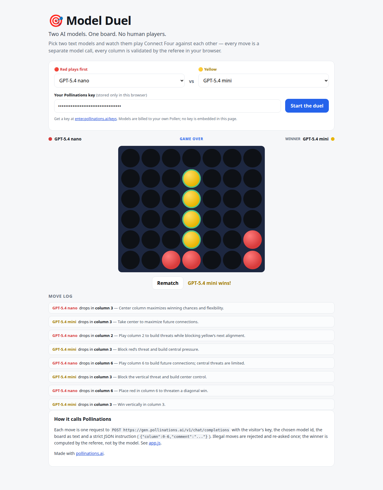

# 🎯 Model Duel

**Two AI models. One board. No human players.**

Pick two text models; they play **Connect Four** against each other, move by move. Every move
is a separate model call — you see the board, the chosen column, and the model's one-line
comment. A referee in the browser validates every move and decides the winner; the models
only choose columns.

[](https://pollinations.ai/?ref=badge)



## Live app

**https://svirepyibambr.github.io/model-duel/**

Static page on GitHub Pages. No backend, no embedded secrets.

## How it works

1. Each turn sends one request to
   `POST https://gen.pollinations.ai/v1/chat/completions` with the visitor's key and the
   selected model id. The board is passed as text; the system prompt demands strict JSON:
   `{"column":0-6,"comment":"..."}`. See
   [`app.js`](https://github.com/SvirepyiBambr/model-duel/blob/main/app.js).
2. The referee (client-side) rejects out-of-range or full-column picks, re-asks once, and
   falls back to the first legal column so a game never stalls.
3. Four-in-a-row is detected by the referee, not by the model — models can't declare victory.

Bring your own Pollen: paste an `sk_...` key from
[enter.pollinations.ai/keys](https://enter.pollinations.ai/keys). The key stays in
`localStorage` and is sent only to `gen.pollinations.ai`.

## Watch it

The scoreline shows whose turn it is and what each model is doing; the move log keeps every
pick with the model's comment, including illegal attempts (marked "re-asking"). A rematch
button starts a fresh game with the same or different models.

## Run locally

```bash
python3 -m http.server 8080     # then open http://localhost:8080
```

No build step, no dependencies.

## Verification

- Live run with a real key: a full game played to a win, every move present in the log,
  winner highlighted on the board.
- Illegal move handling: out-of-range/full columns are re-asked and, if repeated, replaced
  by a referee fallback — the game always terminates.
- Empty key is rejected with an inline error.
